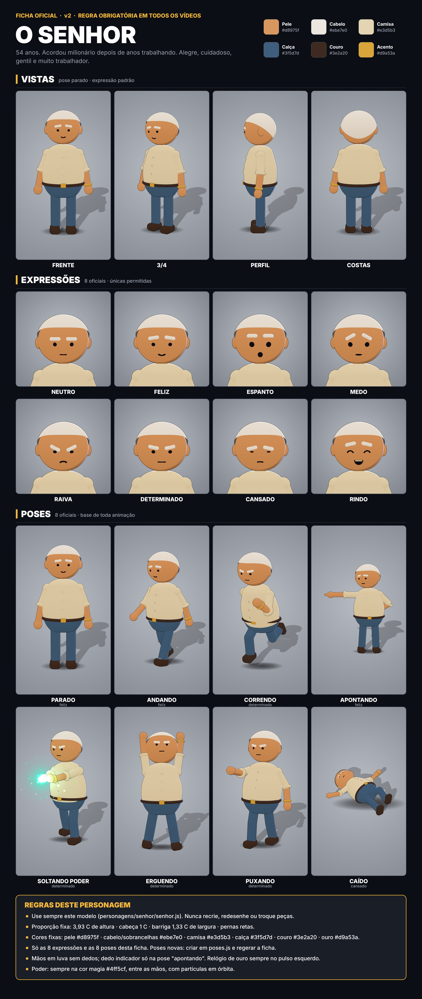

# Ficha oficial — O Senhor (v2 — aguardando aprovação)

> **v2:** acrescenta as poses `erguendo` e `puxando` (pedidas pelo roteiro de Super Força).
> Até aprovar, a v2 só vale para prévias em `previas/`. A v1 aprovada tinha as 6 primeiras poses.

> **Regra obrigatória em todos os vídeos.** Qualquer cena com este personagem usa este modelo,
> estas cores, estas expressões e estas poses. Mudou algo? Atualize a ficha primeiro
> (ver "Como alterar") e aprove a nova `ficha.png`.



## Quem é

54 anos. Acordou milionário depois de anos trabalhando. Alegre, cuidadoso, gentil e muito
trabalhador. Expressão padrão: `feliz`.

## Arquivos

| Arquivo | O que é |
|---|---|
| `senhor.js` | Modelo 3D (única fonte do personagem) |
| `poses.js` | As 6 poses oficiais |
| `ficha.png` | Imagem-resumo (vistas, expressões, poses, regras) |
| `vistas/` | frente, tres_quartos, perfil, costas (1080x1920) |
| `expressoes/` | as 8 expressões em close (1080x1080) |
| `poses/` | as 6 poses (1080x1920) |
| `ficha.json` | Manifesto gerado (não editar à mão) |

## Visual

| Item | Escolha | Cor (paleta) |
|---|---|---|
| Pele | média | `pele_2` #d8975f |
| Cabelo | branco, curto; testa alta, acima das orelhas, cobre a nuca | `cabelo_branco` #ebe7e0 |
| Sobrancelhas | grossas (0,075 C) e brancas | `cabelo_branco` #ebe7e0 |
| Olhos | pequenos e redondos (0,075 C) | `olho` #110f16 |
| Orelhas | redondas, medianas (0,25 C de altura), viradas 26° para a frente | `pele_2` |
| Camisa | social, manga dobrada no cotovelo, 3 botões | `creme` #e3d5b3 |
| Calça | cintura alta, sobe até a barriga | `tecido_azul` #3f5d7d |
| Cinto e sapatos | couro escuro | `couro_escuro` #3e2a20 |
| Acento | fivela + relógio de ouro **no pulso esquerdo** | `ouro` #d9a53a |
| Poder | esfera entre as mãos com partículas em órbita | `magia` #4ff5cf |

## Proporções (C = altura da cabeça)

- Altura total: 3,93 C.
- Cabeça: 1,0 C de altura, 1,06 C de largura.
- Corpo em ovo: barriga 1,33 C de largura; ombros 1,0 C.
- Pernas retas, sem afinar: 0,30 C de espessura; coxa 0,56 + canela 0,54 C (quadril a 1,36 C do chão).
- Braços: 0,58 + 0,52 C; em repouso, afastados 20° pela barriga.

## Expressões oficiais (8)

`neutro` · `feliz` · `espanto` · `medo` · `raiva` · `determinado` · `cansado` · `rindo`

Valores em `motor/rosto.js` e no guia (seção 4.2). Para fala: `definirBoca('fechada' | 'meia' | 'aberta')`.

## Poses oficiais (8)

| Pose | Nome no código | Expressão sugerida | Observação |
|---|---|---|---|
| Parado | `parado` | feliz | repouso do modelo |
| Andando | `andando` | feliz | quadro de contato: perna E e braço D à frente |
| Correndo | `correndo` | determinado | passada no ar, tronco inclinado 17° |
| Apontando | `apontando` | feliz | braço D esticado, **dedo indicador visível**, mão E na cintura |
| Soltando poder | `poder` | determinado | mãos à frente; efeito `poder` entre as mãos |
| Erguendo (v2) | `erguendo` | determinado | braços retos para cima: o objeto apoia nas mãos logo acima da cabeça (~3,95 C) |
| Puxando (v2) | `puxando` | determinado | braço D à frente na altura do ombro, corpo inclinado para trás |
| Caído | `caido` | cansado | de costas, joelho E dobrado, sombra alongada; a raiz fica nos pés |

## Como usar num vídeo

```js
import criarSenhor from '../personagens/senhor/senhor.js';
import { aplicarPose, misturarPoses } from '../motor/poses.js';

const senhor = criarSenhor();
const P = senhor.userData.poses;
aplicarPose(senhor, P.andando, { base: { pos: new THREE.Vector3(1, 0, 0), rotY: 0 } });
aplicarPose(senhor, misturarPoses(senhor, P.parado, P.apontando, t));  // transição
senhor.userData.rosto.definirExpressao('espanto');
senhor.userData.rosto.definirBoca('aberta');
senhor.userData.rosto.piscar(1);
```

## Como alterar (e manter a regra)

1. Editar `senhor.js` (visual) ou `poses.js` (pose nova/ajuste).
2. Subir `versao` em `FICHA` no `senhor.js`.
3. Regerar: `node motor/gerar_ficha.js senhor` (cerca de 16 s).
4. Aprovar a nova `ficha.png` antes de usar em vídeo.

Ver uma combinação avulsa:

```
node motor/gravar.js "motor/vitrine.html?personagem=senhor&pose=poder&vista=tres_quartos&expressao=raiva" previas/teste.png --quadro 0
```

Parâmetros da vitrine: `pose`, `expressao`, `vista` (frente, tres_quartos, perfil, costas ou graus),
`enquadrar` (corpo, rosto), `elev` (graus), `w`, `h`.

## Exceções ao guia (pedidas na descrição do personagem)

- **Olhos redondos** em vez de pílula (guia 4.1): "olhos pequenos e redondos".
- **Orelhas visíveis** (normalmente não aparecem): cabelo curto e "orelha redonda e mediana".
- **Sobrancelhas** 0,075 C de espessura (guia: 0,045 C) e 0,22 C de largura: "grossas".
- **Pernas** 0,30 C (guia: 0,20 C), para sustentar o corpo gordo.
- **Dedo indicador** como peça extra, visível só na pose `apontando`.
